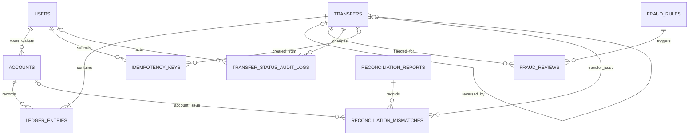

# Milestone 1 — Database schema

PostgreSQL 15+ migration: [`migrations/001_initial_schema.sql`](../migrations/001_initial_schema.sql). It builds the schema from an empty database. Money is stored as whole paise in `BIGINT`; no floating point values are used.

## Noun list and table decisions

| Noun | Table? | Reason |
|---|---|---|
| User | `users` | Stores identity/contact fields and KYC state. |
| Wallet / system account | `accounts` | Both are accounts with balances and ledger activity. `kind` distinguishes user wallets from cash-in, cash-out, and fee revenue accounts. |
| Transfer | `transfers` | Stores the business event, amount, lifecycle status, and optional link to the transfer it reverses. |
| Ledger entry | `ledger_entries` | Stores each immutable debit or credit line for an account and transfer. |
| Idempotency key | `idempotency_keys` | Stores one client key per user, request digest, and the original response/transfer association for retry handling. |
| Fraud rule / review | `fraud_rules`, `fraud_reviews` | Rules are configurable records; each triggered rule on a transfer needs its own review state and decision. |
| Transfer status audit | `transfer_status_audit_logs` | Preserves each status transition with actor and timestamp. |
| Reconciliation report / mismatch | `reconciliation_reports`, `reconciliation_mismatches` | A report groups the nightly run; one row per discrepancy preserves what was found. |
| Currency | No separate table | INR is the only supported currency and is enforced as a check on accounts. |
| Statement / balance | No separate table | Statement is a query over ledger rows; balance is cached on accounts for fast reads and reconciled against ledger history. |
| Plain-English question / answer | No table | It is a request/response over the user-authorized statement, not persistent domain state in the requirements. |

## Attributes

All tables have a generated `BIGINT` primary key named `id`.

- `users`: `name`, `email`, `phone`, `kyc_status`, `created_at`.
- `accounts`: nullable `owner_user_id`, `kind`, `name`, `currency`, cached `balance_paise`, `created_at`. Wallet rows require an owner; system account rows forbid one. Wallet balances are constrained nonnegative.
- `transfers`: `type`, `status`, positive `amount_paise`, `created_at`, optional `reversal_of_transfer_id`.
- `ledger_entries`: `transfer_id`, `account_id`, `direction`, positive `amount_paise`, `created_at`. Direction is separate from amount so stored values remain positive and easy to validate.
- `idempotency_keys`: `user_id`, `idempotency_key`, SHA-256 `request_hash`, nullable `response_body` and `transfer_id`, `created_at`.
- `fraud_rules`: `name`, `description`, `disposition`, `enabled`, `created_at`.
- `fraud_reviews`: `transfer_id`, `fraud_rule_id`, review `status`, flag/review timestamps, optional reviewer and note.
- `transfer_status_audit_logs`: `transfer_id`, old/new status, actor kind and optional user, `changed_at`.
- `reconciliation_reports`: run start/completion, run status, mismatch count.
- `reconciliation_mismatches`: report, mismatch type, optional affected transfer/account, expected/actual paise, details and detection time.

## Cardinalities and foreign keys

| Relationship | Cardinality | Foreign key placement |
|---|---|---|
| User — wallet account | 1:M (a user may have many wallets; each wallet has one owner) | `accounts.owner_user_id`; system accounts leave it null. |
| Transfer — ledger entry | 1:M (at least two lines per transfer) | `ledger_entries.transfer_id`. Deferred trigger checks minimum line count and matching debit/credit totals at commit. |
| Account — ledger entry | 1:M | `ledger_entries.account_id`. |
| Transfer — reversal | 1:0..M (an original may be reversed; each reversal points to one original) | `transfers.reversal_of_transfer_id`, constrained to reversal transfers only. |
| User — idempotency key | 1:M | `idempotency_keys.user_id`, unique with `idempotency_key`. |
| Transfer — idempotency record | 1:0..M | Nullable `idempotency_keys.transfer_id`; a request can be recorded before its transfer is finalized. |
| Transfer — fraud review | 1:M | `fraud_reviews.transfer_id`. |
| Fraud rule — review | 1:M | `fraud_reviews.fraud_rule_id`; together these form the many-to-many relation between transfers and rules. |
| Transfer — status audit event | 1:M | `transfer_status_audit_logs.transfer_id`. |
| User — status audit actor | 1:M, optional for system actor | `transfer_status_audit_logs.actor_user_id`. |
| Reconciliation report — mismatch | 1:M | `reconciliation_mismatches.report_id`. |
| Account/transfer — mismatch | 1:M, optional according to mismatch kind | `reconciliation_mismatches.account_id` / `transfer_id`. |

## ER diagram

## Database protections and query indexes

- Ledger amounts must be positive; debit/credit is an enum column. A deferred constraint trigger rejects a transfer with fewer than two entries or unequal debit and credit totals.
- A wallet account must have an owner and a nonnegative cached balance. System accounts have no owner and may be negative.
- A trigger rejects all ledger entry updates and deletes. The application database role should additionally receive only `SELECT` and `INSERT` on this table.
- Idempotency is unique on `(user_id, idempotency_key)`. Milestone 3 compares `request_hash` on conflict and returns the saved response only for a matching body.
- Indexes support account statements ordered newest first, locating transfer lines, user account listing, reversal lookup, audit history, pending fraud reviews, and report mismatch retrieval.
- Status updates automatically append an audit event. For a user actor, the transaction must set `SET LOCAL wallet.actor_user_id = '<user id>'`; otherwise the event is attributed to the system.

## Design answers and assumptions

**Balance storage:** Store `accounts.balance_paise` and derive the authoritative balance from ledger entries during reconciliation. Cached balances make frequent balance reads inexpensive, but every money-moving transaction must update the cache atomically with ledger inserts. The cache costs write complexity and can drift after bugs; nightly comparison detects that. Computing every balance from all ledger lines would simplify stored state but make reads increasingly expensive.

**One account table:** A ledger line references one account regardless of whether it is a customer wallet or platform account, so a single `accounts` table gives each line one unambiguous FK and lets common balance/statement queries work uniformly. Account kind and owner nullability distinguish the roles.

**External identifiers:** Email and phone are user-controlled and can change, be mistyped, recycled, or have normalization/privacy concerns. They are useful unique contact attributes, not stable database identities. Generated `users.id` is the primary key and foreign keys use it.

**Assumptions:** All amounts are positive integer paise and each account is INR. There is one system account per system kind. Email and phone are unique in their stored representation. A reversal is a new transfer and never edits original entries. User-facing transfer requests have an authenticated user for their idempotency scope. Fraud review decisions are represented by review rows; precise fraud rules and status transition policy are introduced in later milestones. Status actor identity is supplied transaction-locally by the application.
